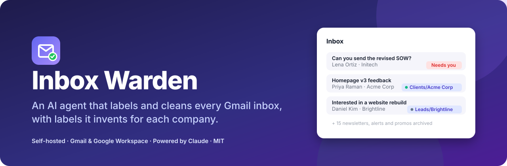
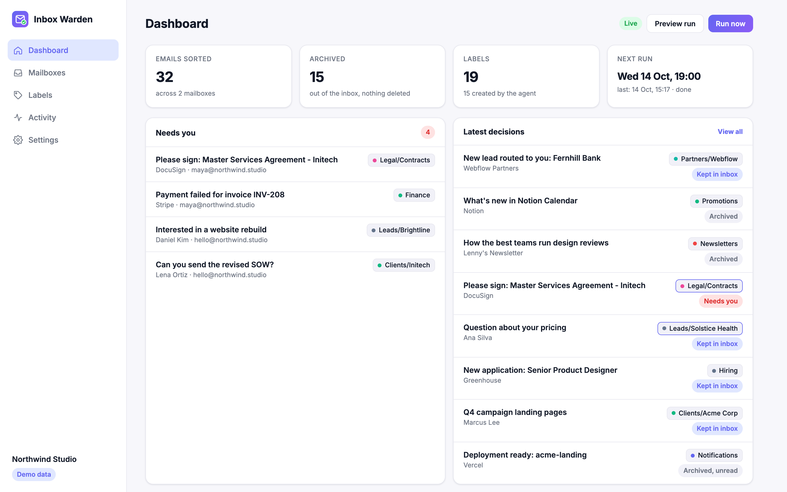
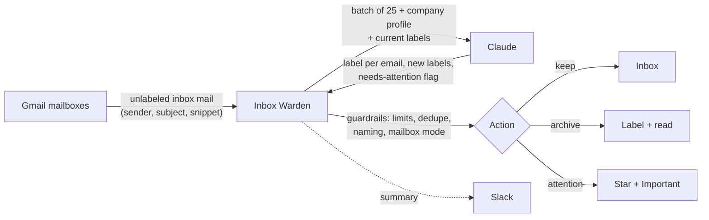
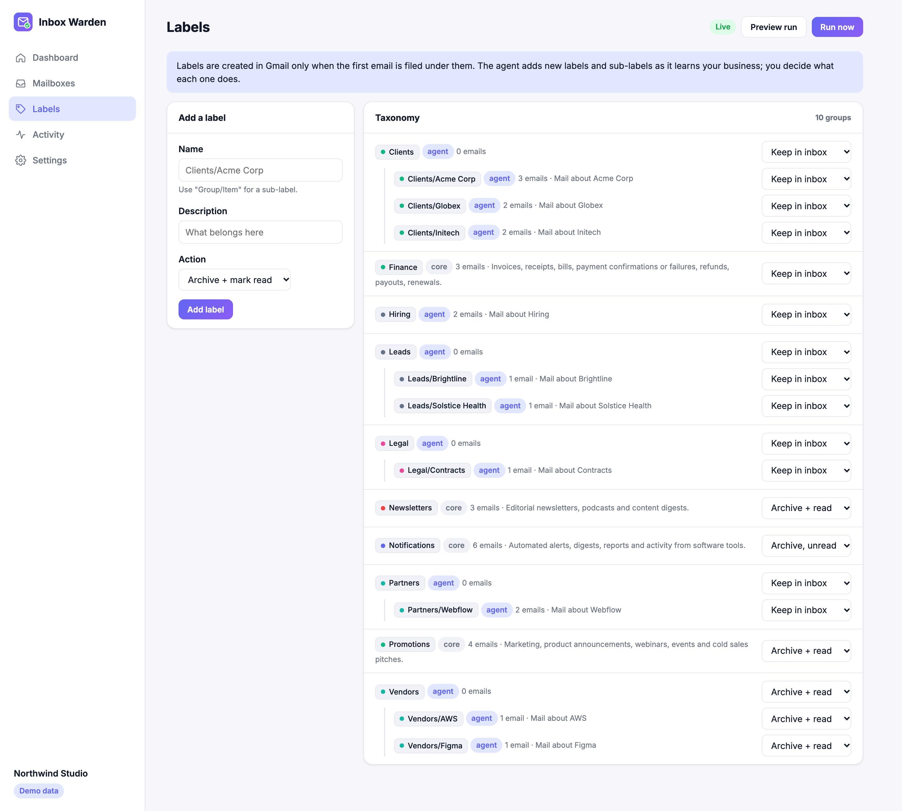
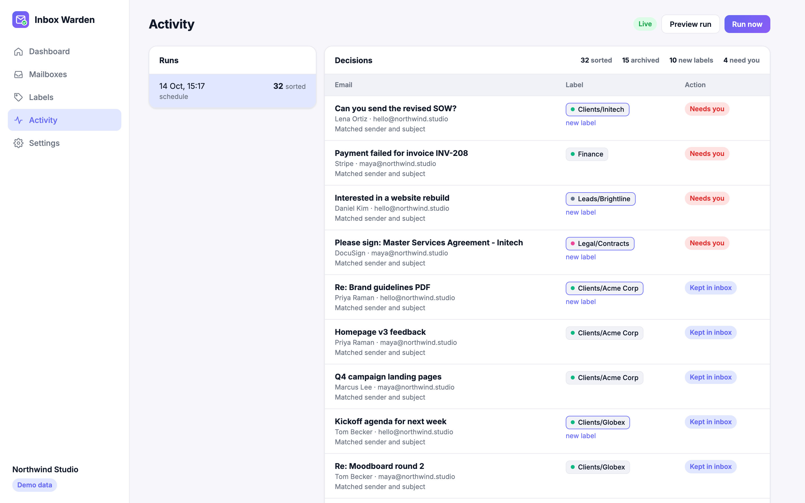
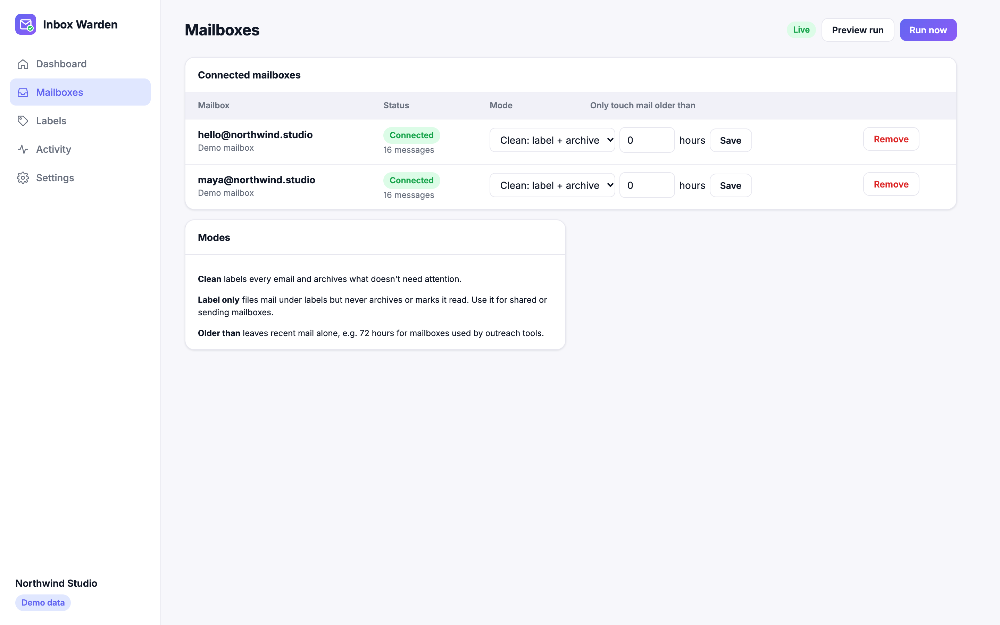
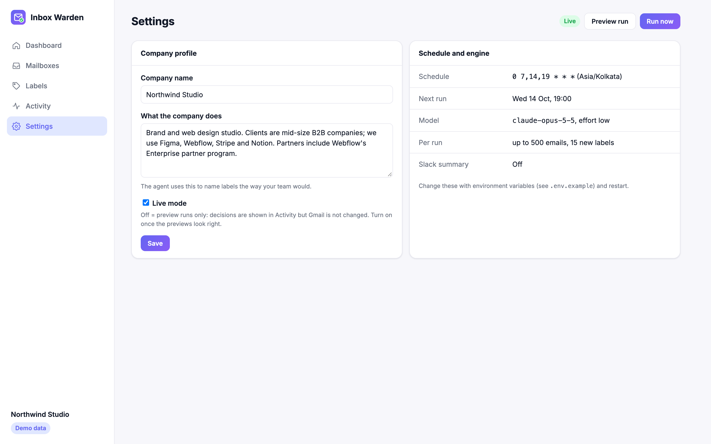
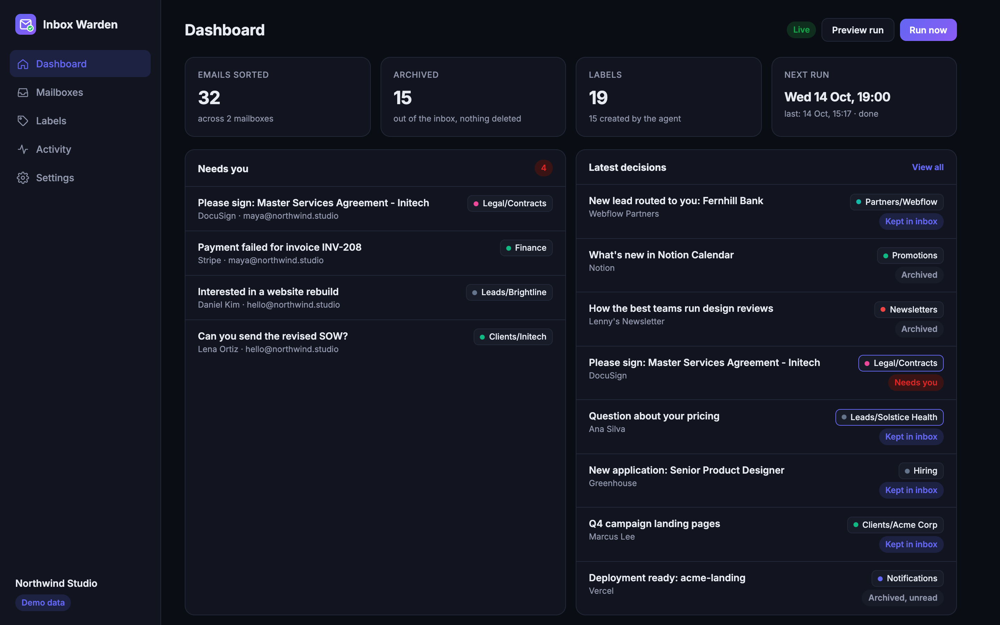

<p align="center">
  
</p>

<p align="center">
  <a href="LICENSE"></a>
  
  
  
  
</p>

<p align="center">
  <b>Connect your mailboxes. Describe your company. Inbox Warden sorts every email into labels that fit your business,<br>
  archives the noise, and flags the few emails that are waiting on you.</b>
</p>

<p align="center">
  <a href="#quick-start">Quick start</a> ·
  <a href="#how-it-works">How it works</a> ·
  <a href="#labels-that-fit-each-company">Labels</a> ·
  <a href="#safety">Safety</a> ·
  <a href="#configuration">Configuration</a> ·
  <a href="docs/google-setup.md">Google setup</a>
</p>

<br>

<picture>
  <source media="(prefers-color-scheme: dark)" srcset="docs/screenshots/dashboard-dark.png">
  
</picture>

## Why

Most inbox tools sort mail into the same generic buckets for everyone. A design studio, a law firm and a SaaS startup
need different folders: their clients, their vendors, their deals. Inbox Warden starts with four core labels and lets
an AI agent grow the rest from the mail itself, so after a few runs your Gmail has `Clients/Acme Corp`,
`Vendors/AWS`, `Partners/Webflow` and whatever else your business actually runs on.

- **Company-specific labels and sub-labels**, created by the agent as it meets new clients, vendors and projects
- **A clean inbox**: low-value mail is labeled, archived and marked read; nothing is ever deleted
- **"Needs you"**: emails where someone is blocked on you are starred and marked important
- **Many mailboxes, one place**: personal Gmail and Google Workspace, connected in a click
- **Runs on a schedule** (default 07:00, 14:00, 19:00) with an optional Slack summary
- **Self-hosted, single-tenant**: one small container per company, your Google project, your API key

## Quick start

### Try it in 30 seconds (demo data, no accounts needed)

```bash
git clone https://github.com/<you>/inbox-warden && cd inbox-warden
docker build -t inbox-warden . && docker run --rm -p 8080:8080 -e DEMO_MODE=true inbox-warden
```

Open [localhost:8080](http://localhost:8080). You get a fictional studio with two mailboxes, already sorted.

<details>
<summary>Without Docker</summary>

```bash
pip install -r requirements.txt
DEMO_MODE=true uvicorn warden.app:app --port 8080
```
</details>

### Run it for real

1. **Google:** create an OAuth client (and optionally domain-wide delegation) in your own Google Cloud project.
   Step-by-step: [docs/google-setup.md](docs/google-setup.md).
2. **Configure:**
   ```bash
   cp .env.example .env    # fill in PUBLIC_URL, ADMIN_PASSWORD, SECRET_KEY, ANTHROPIC_API_KEY, GOOGLE_CLIENT_*
   docker compose up -d
   ```
3. **Connect mailboxes** on the Mailboxes page, describe the company in **Settings**, and click **Preview run**.
4. Check the decisions in **Activity**. When they look right, switch on **Live mode**.

> Inbox Warden starts in **preview mode**: runs show exactly what would happen without touching Gmail.

## How it works



1. **Fetch.** Every run reads only inbox mail that has no label yet, metadata and a short snippet, never full bodies.
2. **Classify.** Claude gets the company profile, the current label taxonomy and a batch of emails, and returns one
   decision per email through structured output: an existing label or a proposed new one, plus a needs-attention flag.
3. **Guard.** Code keeps the final say: at most two levels (`Group/Item`), tidy names, near-duplicates merged,
   a cap on new labels per run, and each mailbox's mode respected.
4. **Apply.** Labels are created in Gmail the first time they are used. The label's action decides what happens next.

## Labels that fit each company



Four **core** labels exist from day one. They are not created in Gmail until an email lands in them.

| Core label | Default action | Catches |
|---|---|---|
| `Finance` | Keep in inbox | Invoices, receipts, failed payments, renewals |
| `Notifications` | Archive, keep unread | Alerts, digests and reports from tools |
| `Newsletters` | Archive + mark read | Newsletters and content digests |
| `Promotions` | Archive + mark read | Marketing, webinars, events, cold pitches |

Everything else is **created by the agent** for your business, for example:

```
Clients/Acme Corp      Leads/Brightline       Partners/Webflow
Clients/Globex         Leads/Solstice Health  Vendors/AWS
Legal/Contracts        Hiring                 Projects/Website Redesign
```

Every label has one of three actions, and you can change any of them on the Labels page:

| Action | What happens to the email |
|---|---|
| **Keep in inbox** | Labeled, stays in the inbox |
| **Archive + mark read** | Labeled, leaves the inbox, marked read |
| **Archive, keep unread** | Labeled, leaves the inbox, stays unread so the label shows what's new |

On top of that, any email where a person or process is blocked until you act (a client waiting on a reply, a failed
payment, a contract to sign) is **starred and marked Important** and stays in the inbox.

## Screenshots

<table>
  <tr>
    <td width="50%"><p align="center"><b>Activity</b>: every decision, with the reason</p></td>
    <td width="50%"><p align="center"><b>Mailboxes</b>: connect, choose a mode per mailbox</p></td>
  </tr>
  <tr>
    <td width="50%"><p align="center"><b>Settings</b>: company profile and live mode</p></td>
    <td width="50%"><p align="center"><b>Dark mode</b> follows your system</p></td>
  </tr>
</table>

## Mailbox modes

| Mode | Use it for |
|---|---|
| **Clean** | Normal mailboxes: label everything, archive what doesn't need attention |
| **Label only** | Shared or sending mailboxes: label, never archive or mark read |
| **Paused** | Keep the mailbox connected but skip it |

Each mailbox can also skip mail younger than N hours, e.g. 72 hours for mailboxes used by outreach or warmup tools,
so those tools see replies and bounces first.

## Safety

- **Nothing is deleted or sent.** The code has no delete, trash or send path; it only adds and removes labels.
  Archived mail is one click from the inbox.
- **Preview mode first.** New installs only record what they would do until you switch on Live mode.
- **Least data.** Claude sees sender, recipients, subject and a ~300 character snippet, never full bodies or attachments.
- **Prompt-injection aware.** Email content is passed as data and the agent is told never to follow instructions in it.
  Its only power is choosing a label, and code validates every label it proposes.
- **Your keys, your project.** OAuth refresh tokens are encrypted at rest with your `SECRET_KEY`;
  Google access goes through your own Google Cloud project.

## Configuration

All settings are environment variables (see [.env.example](.env.example)).

| Variable | Default | |
|---|---|---|
| `PUBLIC_URL` | `http://localhost:8080` | Where the app is reachable; used for Google sign-in |
| `ADMIN_PASSWORD` | | Password for the web app |
| `SECRET_KEY` | | Signs sessions and encrypts stored tokens |
| `ANTHROPIC_API_KEY` | | Claude API key |
| `ANTHROPIC_MODEL` | `claude-opus-5-5` | Any current Claude model; `claude-haiku-5-5` costs far less per email |
| `ANTHROPIC_EFFORT` | `low` | Reasoning effort for classification |
| `GOOGLE_CLIENT_ID` / `GOOGLE_CLIENT_SECRET` | | OAuth client for "Connect with Google" |
| `GOOGLE_SERVICE_ACCOUNT_FILE` | | Optional Workspace domain-wide delegation key |
| `SCHEDULE` | `0 7,14,19 * * *` | Cron schedule |
| `TZ` | `UTC` | Timezone for the schedule |
| `MAX_EMAILS_PER_RUN` | `500` | Upper bound per run |
| `MAX_NEW_LABELS_PER_RUN` | `15` | Keeps the taxonomy from sprawling |
| `SLACK_WEBHOOK_URL` | | Post a summary after every run |
| `DEMO_MODE` | `false` | Fake mailboxes and a rule-based classifier, no credentials needed |

## Running it for clients

Inbox Warden is single-tenant on purpose: deploy **one instance per company**. Each instance has its own Google
project (or OAuth client), its own label taxonomy and its own company profile, so labels and data never mix.
A small VPS or any container host (Coolify, Railway, Render, Fly.io) runs it comfortably; data lives in one SQLite
file in the `/data` volume.

## Project layout

```
warden/
  app.py          web app, Google sign-in, scheduler
  agent.py        one cleanup run: fetch, classify, guardrails, apply
  classifier.py   Claude structured-output classifier (+ demo classifier)
  taxonomy.py     core labels, label rules, dedupe
  gmail.py        Gmail API and demo backends
  db.py           SQLite storage
  templates/      UI
```

## Roadmap

- Outlook / Microsoft 365 mailboxes
- Learn from manual corrections (moving an email to another label teaches the agent)
- MCP server so assistants like Claude can search and act across all connected mailboxes
- Per-label rules ("always archive mail from this sender")

## Contributing

Issues and pull requests are welcome. Run the demo (`DEMO_MODE=true`) to work on the UI without any credentials.

## License

[MIT](LICENSE)
